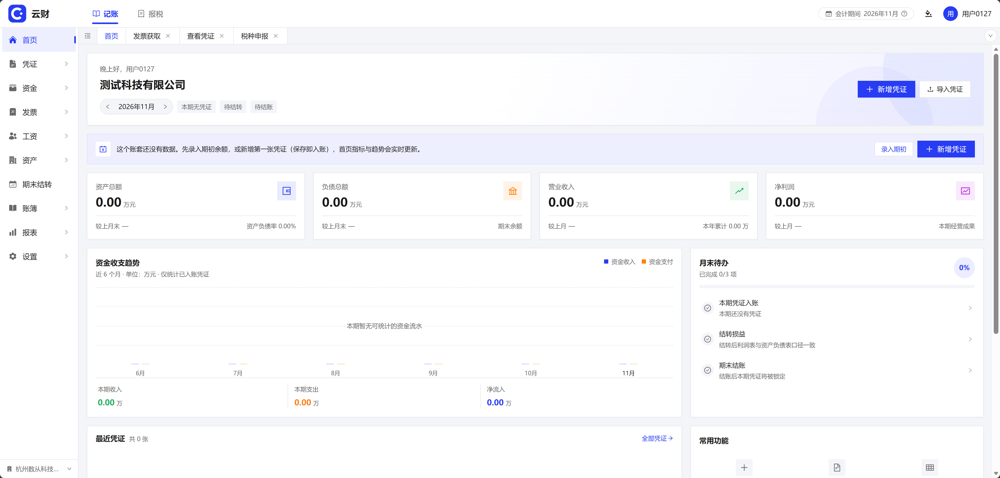
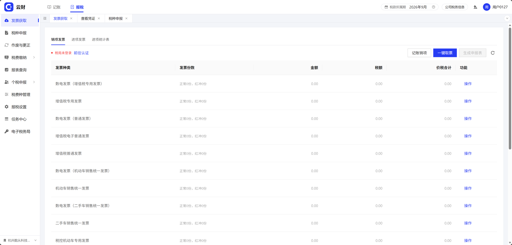

<p align="center">
  
</p>

<h1 align="center">云财（YunCai）</h1>
<p align="center">
  开源免费企业级财务系统
</p>

<p align="center"><sub>不想自己部署就直接使用 <a href="https://yuncai.datawalk.cn">yuncai.datawalk.cn</a>；可直接注册使用，功能与开源版一致。</sub></p>

## 为什么选云财

- **建好账套就能做账**：凭证、账簿、结转、报表一条龙跑通，默认小规模纳税人，兼容 2001 版《企业会计制度》与新准则科目。
- **一键取数报税**：发票、税费种、申报表、完税证明直接从税局取回，告别手工抄数（直连目前已在浙江验证）。
- **记账之外还能管钱管物**：出纳日记账与收支智能匹配、固定资产、工资、票据、电子档案。
- **多账套随手切**：一个账号管多套账，代账公司也够用。
- **私有化部署**：部署在自己服务器，账务数据不出内网。
- **开源免费**：账套数、用户数、功能都不设限，可以自己改。

## 界面预览

<p align="center">
  
</p>

<p align="center"><sub>首页 —— 本月资产 / 负债 / 收入 / 利润概览，资金收支趋势与期末待办</sub></p>

<p align="center">
  
</p>

<p align="center"><sub>智能报税 · 发票获取 —— 按票种汇总销项发票份数、金额、税额与价税合计</sub></p>

## 功能一览

| 领域 | 主要能力 |
| --- | --- |
| 账套与基础档案 | 多账套、币别、凭证字、重新初始化、科目层级与期初、七类辅助核算 |
| 凭证 | 手工录入、Excel 导入、常用模板、反过账、保存即过账 |
| 账簿 | 总账、明细账、多栏账等全套账簿 |
| 报表 | 科目余额表、资产负债表、利润表/季报、现金流量表、部门/项目利润表、费用明细、所有者权益变动、纳税统计、自定义报表 |
| 资金出纳 | 日记账、收支智能匹配、内部转账、批量生成凭证、资金报表与总账核对 |
| 期末 | 损益结转、自定义结转模板、批量结账、撤销结转 |
| 资产与其他 | 固定资产、发票、工资、电子档案（分类归档与附件）、预算、费用 |
| 智能报税 | 税费种、申报表、缴款、完税证明取数，一键取票，个税申报，ITS 查询统计（直连目前仅在浙江验证） |
| 审计与身份 | 操作日志、用户与权限、登录认证 |

## 技术栈

| 层 | 选型 |
| --- | --- |
| 后端 | ASP.NET Core / .NET 10、MediatR、Serilog、JWT Bearer、EF Core + Npgsql |
| 数据库 | PostgreSQL 17 |
| Excel / PDF | MiniExcel（.xlsx）、NPOI 2.8（.xls 凭证）、PaperSharp（PDF） |
| 前端 | React 19、TypeScript 6、Vite 8（rolldown）、antd v6、Tailwind CSS 4、react-router 8、React Compiler |
| API 客户端 | openapi-generator（typescript-fetch），产物在 `ui/src/apis-gen/` |
| 检查 | oxlint（前端）、xUnit + coverlet（后端） |

## 目录结构

```text
.
├── docs/                        设计、调研、部署、测试规范
├── src/
│   ├── YunCai.slnx
│   ├── YunCai/                  后端主项目
│   │   ├── Modules/<上下文>/    Domain / Application / Infrastructure / Api
│   │   ├── Shared/Infrastructure/   AppDbContext 与全局基础设施
│   │   ├── Migrations/          EF Core 迁移（当前 100+ 个）
│   │   └── Program.cs           组合根：DI 注册与运行时基线
│   ├── YunCai.Tests/            后端单元测试
│   └── TaxAssistant/            税局辅助工具
├── ui/
│   ├── src/apis-gen/            生成代码，禁止手改
│   ├── src/api/                 手写 API 封装（auth、accountSets）
│   ├── src/pages/business/      业务页面（正式 UI）
│   ├── src/pages/               既有实页（vouchers、ledger、reports…）
│   └── src/accountSets/         当前账套 Context
├── scripts/                     覆盖率报告等辅助脚本
├── .github/workflows/           CI 与镜像发布
├── docker-compose.yml           本地/单机部署：db + migrate + api + web
├── docker-compose.acr.yml       从 ACR 拉镜像的覆盖层
└── AGENTS.md                    开发约定、领域须知、常见陷阱
```

模块边界：跨模块只能引用对方 **Domain**，Application / Infrastructure 不跨模块引用。新业务放进对应模块，不要回填到根级分层。

## 本机开发

前置条件：.NET 10 SDK、Node.js 24、PostgreSQL 17（本地或 Docker）。

### 1. 配置后端

在 `src/YunCai/` 下创建 `appsettings.Development.json`（该文件已被 `.gitignore` 排除，不要提交）。仓库文档里提到的 `appsettings.Development.example.json` 模板当前缺失，可直接用下面这份最小配置起步：

```json
{
  "ConnectionStrings": {
    "DefaultConnection": "Host=localhost;Port=5432;Database=yuncai;Username=postgres;Password=你的数据库密码"
  },
  "Jwt": {
    "Key": "换成至少32位的随机字符串"
  },
  "YunCai": {
    "Database": { "AutoMigrate": true },
    "Networking": {
      "HttpsRedirection": false,
      "UseHsts": false
    }
  }
}
```

随机密钥可用 `openssl rand -base64 48 | tr -d '/+='` 生成。连接串为空或 `Jwt:Key` 缺失/短于 32 位时，进程会**直接启动失败**——这是设计行为。系统不预置任何账号：起来后在登录页注册手机号，再按建账引导建账套。开发环境必须关掉 HTTPS 跳转，否则本地 http 访问会被打断。

### 2. 启动服务

```bash
# 终端 1：后端 http://localhost:5271
cd src/YunCai
dotnet run

# 终端 2：前端 http://localhost:5173，/api 代理到 5271 并去掉 /api 前缀
cd ui
npm install
npm run dev
```

用完整的 `dotnet run` 启动（不要加 `--no-build`），否则可能遇到 EF 的 `PendingModelChangesWarning`。Windows PowerShell 不支持 `&&`，请按上面分行的形式执行。

### 3. 重新生成 API 客户端

后端 API / DTO 有改动后，保持 5271 在运行，然后：

```bash
cd ui
npm run gen
```

OpenAPI 文档只在 Development 环境暴露（`/openapi/v1.json`）。`ui/src/apis-gen/` 由生成器覆盖，任何手改都会丢失。

### 4. 测试

```bash
# 后端测试
dotnet test src/YunCai.Tests/YunCai.Tests.csproj --nologo

# 覆盖率（CI 同款口径，剔除 EF Migrations）
dotnet test src/YunCai.Tests/YunCai.Tests.csproj --nologo \
  --collect:"XPlat Code Coverage" --settings coverlet.runsettings --results-directory .coverage
node scripts/coverage-report.mjs --gate 40

# 前端检查
cd ui
npm run lint
npm run build
```

前端类型检查可单独跑 `npx tsc -b tsconfig.app.json`。覆盖率门禁与口径见 [`docs/测试规范.md`](docs/测试规范.md)。

## 部署

- **Docker Compose（推荐起步）**：`cp .env.example .env`，填好 `YUNCAI_DB_PASSWORD`、`YUNCAI_JWT_KEY`，`docker compose up -d --build`；`migrate` 容器先跑 `--migrate-only` 建结构，主服务起来后在登录页注册账号、按建账引导建账套。`api` 不映射宿主机端口，外部只能经 nginx 访问，这是登录限流按真实 IP 生效的前提。
- **镜像发布**：推 `v*` 标签触发 `.github/workflows/release-image.yml`，构建并推送 `api` / `web` 镜像到 ACR；服务器用 `docker-compose.acr.yml` 按版本号拉取与回滚。

完整步骤、环境变量、TLS、备份恢复与排障见 [`docs/部署上线说明.md`](docs/部署上线说明.md)。

## 已知边界

- 尚无用户↔账套授权与角色权限：登录用户对可见账套都有完整读写权，当前只适合单人 / 可信内部使用。
- 凭证、日记账等列表接口全量返回，服务端没有分页，单期数据量大时首屏会变慢。
- 上传上限 32MB，电子档案附件以 Base64 存库，账套多了会明显膨胀数据库。
- 前端单包约 1.4MB（gzip 365KB），尚未做路由级分包。
- 智能报税直连仅在浙江验证；个税 ITS 明文链路只跑通编译，真机（需短信登录）尚未验证明文回流。
- `ui/src/pages/business/*` 与 `ui/src/pages/{vouchers,ledger,funds,reports,settings,closing}` 两套页面并存，数据链路接法不同；改取数前先确认改的是哪一套。`pages/home`、`pages/vouchers/import` 是不可达的孤儿代码。
